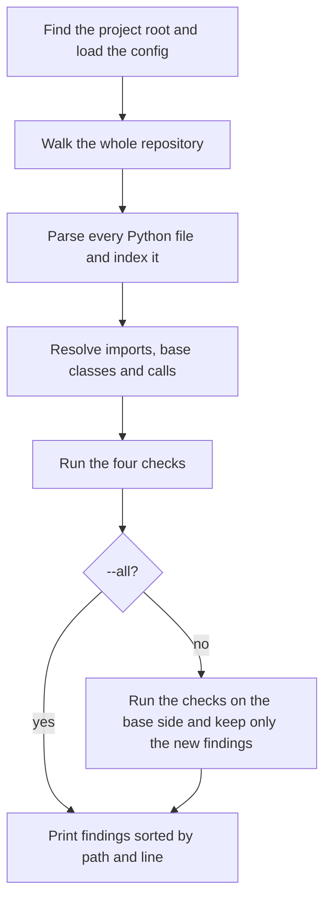

# How it works

dermestes counts the users of an abstraction. When the count is one or zero,
it reports the abstraction as a deletion candidate, with the evidence and the
edit that removes it. It never judges complexity or style, and it never
rewrites code.

It reads Python source with tree-sitter. It does not import or run your code,
use the network, or call a model, so the same input always gives the same
output.

## An example

```python
# src/net.py
def fetch(url, retries=3, timeout=10):
    return url, retries, timeout


def fetch_page(url):
    return fetch(url)


def _label(name):
    return name.strip().title()


def _old_total(rows):
    total = 0
    for r in rows:
        total += r
    return total


def main():
    print(_label(" a "))
    return fetch_page("x")


if __name__ == "__main__":
    main()
```

`dermestes --all` prints one block per finding:

```
const-param src/net.py:1 fetch
  calls: 1 prod, 0 test
  retries: default 3 never overridden
  timeout: default 10 never overridden
  suggest: drop retries, use 3 inline; drop timeout, use 10 inline
pass-through src/net.py:5 fetch_page
  form: forward → src/net.py:1 fetch; calls: 1 prod, 0 test
  suggest: call fetch directly at src/net.py:22, delete fetch_page
pass-through src/net.py:9 _label
  form: single-use; calls: 1 prod, 0 test
  suggest: inline at src/net.py:21, delete _label
dead-code src/net.py:13 _old_total
  calls: 0 prod, 0 test
  suggest: delete _old_total
```

The first line of a block is the check id, the location and the name. The
indented lines are the evidence, and the last one is the fix.

## A run



1. **Root and config.** The project root is the nearest ancestor directory
   with `.git`, else the nearest with `pyproject.toml`, else the current
   directory. Configuration is `[tool.dermestes]` in the `pyproject.toml`
   there.
2. **Walk.** The walk honours `.gitignore` and the `exclude` globs. It covers
   the whole repository even in diff mode, because counting users needs every
   file. It also reads the words of non-Python text files (templates, TOML,
   Markdown), which the `dead-code` check uses.
3. **Index.** Each file is parsed in parallel. The index records classes,
   functions and their parameters, calls and their arguments, the import
   table, `__all__`, and every line that mentions each name. A file with a
   syntax error is skipped with a one-line note on stderr. A generated file
   (`Do not edit` or `DO NOT EDIT` in its first 5 lines) is skipped too.
4. **Resolve.** Imports, base classes and calls are traced to definitions
   inside the repository. See [Resolution](#resolution).
5. **Check.** Each check counts users and applies the [guards](#guards).
6. **Diff.** By default dermestes reports only what your change introduced.
   It rebuilds each changed file as it was at the base (`HEAD`, or the
   `--base` ref) from `git diff`, runs the checks on that side too, and keeps
   the findings that exist only at head. `--all` skips this step and reports
   everything.

Exit code `0` and no output means nothing to report. `1` means findings were
printed. `2` means a usage or internal error.

## Resolution

A use counts only when dermestes can trace it to the definition. Anything it
cannot trace is unknown, and nothing that depends on an unknown is reported.
A false positive costs trust; a miss costs little, because review still
happens afterwards.

- **Imports.** `import a.b`, `from a import b as c`, relative imports and
  re-exports through `__init__.py` are followed. Module roots are the
  repository root and every directory holding a `pyproject.toml`, each with
  its `src/` if it has one.
- **Classes.** A class with a base that cannot be resolved is never reported,
  and neither is any of its ancestors.
- **Calls.** These forms resolve: `f()` through the enclosing scopes and the
  module, `mod.f()` through imports, `self.m()`, `cls.m()` and `super().m()`
  through the class's bases, and `Class()` as a call to `__init__`.
- **Possible calls.** Any other call, such as `obj.done()` on a variable, is
  kept by method name only. It never counts toward a finding, but it blocks
  one when its arguments could bind to the function with a different value.

## The checks

| id | Reports |
|---|---|
| [`one-impl`](#one-impl) | An ABC or Protocol with exactly one production implementation |
| [`const-param`](#const-param) | A parameter that gets the same value at every call site |
| [`pass-through`](#pass-through) | A function that only forwards to, renames or wraps one call |
| [`dead-code`](#dead-code) | A function no production code mentions |

The ids are stable. They appear in the output and in the `disable` config key.

### one-impl

Reports an `ABC` or `Protocol` that has exactly one implementation in
production code.

```
one-impl src/pay/gateway.py:4 PaymentGateway (ABC, 1 abstract methods)
  impl: src/pay/stripe.py:4 StripeGateway
  suggest: inline into StripeGateway, delete PaymentGateway
```

- A Protocol's implementations are counted structurally: a class implements
  it when it has the Protocol's methods, whether or not it subclasses it.
- An intermediate abstract class is not an implementation. A class is
  abstract only while it has unimplemented abstract methods.
- A test implementation (a fake or a stub) is a second implementation, so the
  check stays silent.
- A plain base class with no abstract methods and one subclass is not
  reported. That shape also matches exception hierarchies and mixins.
- An ABC passed to `X.register(...)` is exempt.

### const-param

Reports a parameter that every call site gives the same value. It has two
forms.

- **Never overridden.** The parameter has a default and no call passes
  anything else. One call site is enough. A call that writes the default out
  explicitly does not override it; the finding lists such calls so you can
  remove the argument.
- **Always the same value.** Every call passes the same literal or the same
  module-level constant. This needs at least two production call sites. A
  value written at a single call site is that caller's decision.

```
const-param strips.py:1 compose
  calls: 2 prod, 0 test
  border: always "cr"
  suggest: drop border (and the argument at a.py:5, b.py:5), use "cr" inline
```

- "The same value" means a literal (`True`, `None`, `0.5`, `"cr"`), a module
  constant resolved to its definition, or the parameter left out. Two calls
  that both pass a variable named `conn` do not pass the same value.
- A test call that passes a different value counts as variation, so the
  check stays silent. So does a constant that a test patches.
- `Class(...)` calls are checked against `__init__`.
- All of a function's parameters share one block, with a line per parameter.

### pass-through

Reports a function that adds only a name. It has three forms, shown in the
`form:` line.

- **`forward`.** The body is one `return f(...)`, `await f(...)` or `f(...)`
  where `f` is a repository function. Every argument is a parameter, a
  `self`/`cls` attribute, a short literal, or one `UPPER_CASE` constant. Any
  number of callers. An override whose body only calls `super()` with the
  same arguments is also a forward.
- **`single-use`.** A private function (`_name`) whose body is one simple
  statement of at most 2 lines, with exactly one production call site.
- **`rename`.** A private function with the single-use shape whose body is
  one call to something outside the repository, such as
  `date.fromisoformat(v)`, passing only its own parameters, with exactly two
  production call sites.

```
pass-through dates.py:4 _parse
  form: rename; calls: 2 prod, 0 test
  suggest: call date.fromisoformat(v) directly at dates.py:9, dates.py:13, delete _parse
```

- Any test that calls or patches the function blocks the finding: the test
  makes it a seam.
- A public wrapper of a private function is not reported. It is that
  function's public name.
- A forward that binds a constant is reported only when the wrapper is
  private, binds nothing else, and has at most two production call sites.
- `single-use` and `rename` skip functions annotated `-> bool` (a named
  predicate earns its name), nested functions, and bodies that are `if`,
  `for`, `with` or `try`. `rename` also skips functions with an `Any`
  parameter.
- A function named in `[project.scripts]` or `[project.entry-points]` is
  exempt.

### dead-code

Reports a module-level function or a method whose name no production code
mentions outside its own body. It has two forms: nothing mentions it, or only
tests do.

```
dead-code src/report.py:543 _fetch_cost_rows
  calls: 0 prod, 2 test
  tests: tests/test_report.py:30, tests/test_report.py:41
  suggest: delete _fetch_cost_rows and the tests that only exercise it, or move it into tests/test_report.py if they use it as setup
```

- This check counts mentions of the name, not resolved calls. A mention is an
  identifier or attribute with that name on any receiver, a string that
  spells it (`"f"`, `"pkg.mod.f"`, `"pkg.mod:f"`), or the word in any
  non-Python file. Counting mentions over-counts uses, so the check can only
  miss, never accuse a function that a registry or a template uses.
- A public name is reported only outside a package that ships `py.typed`. In
  a typed package it may be API for callers outside the repository.
- Entry points, Alembic `upgrade` and `downgrade`, and `_repr_*_` display
  hooks are exempt.
- It is not a reachability analysis. A function whose only callers are
  themselves dead is not reported until they are deleted.

## Guards

These apply before any check reports. Each one exists because the pattern
produced false positives on real repositories.

- **Test code is never a target.** Files matching `test-paths` are counted as
  test users, separately from production users.
- **Public names are exempt**: names in `__all__`, names re-exported from an
  `__init__.py`, and files matching the `public` globs.
- **Dunder methods are exempt**, except that `const-param` checks `__init__`.
- **Dynamic lookups are exempt.** A name passed as a string to `getattr`,
  `setattr`, `hasattr`, `patch` or `patch.object`, or used as a key in a
  registry dict (`{"csv": CsvExporter}`), is in use. Docstrings and string
  type annotations do not count.
- **Examples and docs are evidence only.** Code under `examples/**`,
  `docs/**` and `**/test/resources/**` is indexed, so its calls count, but it
  is never reported.

All checks except `one-impl` also exempt:

- **Decorated functions.** Routes, fixtures, CLI commands and DI providers
  are called by a framework. `@staticmethod`, `@classmethod` and
  `@abstractmethod` do not exempt, and `ignore-decorators` lists others that
  should not.
- **Functions used as a value.** A function that is passed as an argument,
  assigned, returned or stored (`Depends(f)`, `partial(f)`) has call sites
  dermestes cannot see.
- **Overrides and overridden methods**, abstract and Protocol methods, and
  every method of a class with a base outside the repository.
- **Functions called only under `if __name__ == "__main__":`.**

To keep one finding on purpose, put `# dermestes: keep <reason>` on any line
of the definition's header. The reason is mandatory.

## Where to go next

- [Setup](guide/setup.md) installs and configures dermestes.
- [Triage](guide/triage.md) says what to do with each finding and lists the
  known misses.
- [Tune](guide/tune.md) describes the config keys and every exemption.
